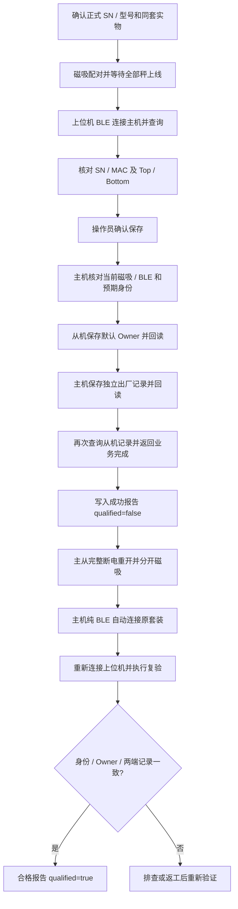

# BLE 出厂配对操作说明

适用：SC200-D 显示主机，通过 Windows 蓝牙连接；单秤支持 SC201-S / SC202-S，双秤仅支持两台 SC202-S。

本功能把**设备当前已有的 SN、MAC、型号和套装角色**保存为独立出厂默认配对，**不会改写设备自身 SN**。普通磁吸配对不会自动成为出厂默认。只有操作员执行保存或明确返工，才写这份记录。

## 一、软件准备

1. 使用本次提供的带“出厂配对”页的上位机。源码位于 `G:\rtt_db`；启动源码可运行 `python rtt_ble_launcher.py`。
2. 主机须更新到本次支持 **BLE `factory.pair`** 的固件；仅版本显示 `V001_004` 不能区分是否具备该接口，请用本次交付包。旧固件的 `fp_save` 只有 RTT/UART 入口，无法直接接收本页命令。
3. 秤须支持既有 `factory.pair` 两端固化协议（本工程配套 V001_004 从机支持）。本次无需修改从机代码。
4. Windows 蓝牙打开；主机设置中的 **BLE 开关打开**，退出手机 App 的连接。上位机连接 **SC200-D 主机**；不要直接连接秤。
5. 本页使用 mlink 服务 `6b1a0001-c701-4e11-9a2c-7e5d00a11e55`，不是 DFU 服务。同一工具的 DFU、串口资源传输与出厂配对互斥，先完成上一项并断开连接。

## 二、单秤套装固化（首次出厂或原来无记录）

1. 确认这台主机与这台秤就是准备装入同一套成品的设备。先完成型号和正式 SN 的写入；**固化后不要再改 SN**。
2. 两端开机，主机与该秤磁吸，等待主机正常显示重量。至少保持一台秤磁吸；上位机不代替磁吸配对。
3. 打开上位机，选择 **“出厂配对”** 页，点击 **“扫描主机”**。
4. 在列表选择对应的 `SC200-D …`，核对广播地址，点击 **“连接并查询”**。默认地址类型为 `public`；固件采用随机地址时再改 `random`。扫描只列 SC200-D 前缀；也可手工输入主机地址后连接，连接后仍会核对型号。
5. 等待页面列出主机 SN / MAC / 固件和“当前在线”秤的 SN / MAC / 型号；确认只有本套装这一台。尚未缓存 SN 时主机会自动查询约 5 秒；不能取得身份时不会固化。
6. “单秤 / Top 上秤”选择该秤。核对磁吸状态为“吸合”，点击 **“保存出厂配对并回读”**，在确认窗口逐项核对主从 SN / MAC 后确认。
7. 等待显示 **“主从出厂记录保存并回读成功”**。主机此时已向从机保存默认 Owner、回读从机记录，并保存/回读自己的出厂套装；这里只完成写入验证，**还不能按最终合格放行**。
8. 自动生成 `logs\factory_pair\…_write_readback.json`，`qualified=false`。可点击 **“导出报告”**另存到产线目录。
9. 接着完成下节的断电复验。

## 三、完整断电与纯 BLE 复验（必须完成后才合格）

1. 在本页点击 **“断开”**。移开磁吸；移除主从机 USB、J-Link 等外接供电，分别关机，等待均完全熄灭。产线须确保两端实际完成断电；不要以软件复位替代本步。
2. 主从机重新开机，保持磁吸分开，等待主机通过 BLE 自动连接原套装。双秤必须两台均重新连接。
3. 本页重新扫描并 **“连接并查询”**同一主机，核对“出厂记录”与实物身份一致，在线秤显示“分开”。
4. 勾选 **“已将主从机完整断电重开，并移开磁吸”**，点击 **“纯 BLE 复验”**。
5. 主机检查所有出厂秤均在线、当前载体是 BLE、没有 UART/磁吸，并向每台秤读取其出厂 Owner 与本机身份比对。
6. 出现 **“产线复验通过”**且报告 `qualified=true`，才标记此套装合格。保存 `…_cold_power_ble_verify.json`；报告中的断电确认来自操作员，工具无法测量设备是否真正掉电。
7. 放上/取下砝码，确认重量更新。正式验收还应抽检恢复出厂后是否回到原套装；恢复流程只读独立出厂记录，不改写该记录。

## 四、双秤套装

1. 主机切双秤模式；依次磁吸配对两台 **SC202-S 大秤**，等待两台均在线，至少一台保持磁吸。SC201-S 小秤、大小混用或两台小秤均不可固化为双秤套装。
2. 连接主机查询后，应列出两台不同的 SN / MAC。“单秤 / Top 上秤”选择实际顶部秤；“Bottom 下秤”选择实际底部秤。保存顺序固定为 **Top、Bottom**。
3. 保存并回读；随后将三台设备均完整断电重开，分开磁吸，待两台秤纯 BLE 自动连回，执行复验。
4. 主机要求本次套装包含**全部在线秤**，不会只固化其中一台。若混入其他设备，先处理当前配对/连接，再查询确认。

## 五、已有出厂记录或返工

| 情况 | 操作 |
|---|---|
| 无出厂记录 | 核对当前套装后，普通保存 |
| 已有且与本次套装完全一致 | 普通保存可幂等确认，不替换其他套装 |
| 已有不同套装，确需返工换板/换秤 | 核对新套装，勾选“返工”，点击“返工替换并回读”，再次确认；随后重新断电复验 |
| 记录损坏、身份与记录不符、读取失败 | 普通保存和返工均不绕过；先按错误排查，不猜测或自动重建旧记录 |
| 写入回执丢失或中途掉电/断连 | 显示结果未确认，重新连接查询两端；不要因超时直接返工。两端写入非跨设备原子事务，失败时可能有一端已写入，需确认状态后幂等重试原套装 |

返工只替换本次在线新套装的相关记录及主机记录；不远程擦除已被换下且不在线的旧秤，旧秤需按返工工艺单独处理。

## 六、常见失败

| 显示/错误 | 排查 |
|---|---|
| 找不到主机 | 开 BLE、关闭手机占用、靠近主机；确认广播名 SC200-D；必要时输入主机地址 |
| 主机拒绝命令 | 主机还是旧固件，更新本次 BLE 出厂配对固件 |
| `identity_unavailable` / `snapshot` | 等待秤上线，核对 SN/型号、BLE 握手及磁吸；不要仅看到 BLE connected 就固化 |
| `expected_identity` / `expected_count` / `expected_sn` | 操作期间套装变化或 SN/MAC 不一致；重新查询并核对实物 |
| `locked_use_fp_rework` | 已有不同出厂套装；确认确需返工后，才使用返工按钮 |
| `remote_store` / `remote_readback` / `remote_verify` | 秤固件/连接/默认 Owner 或存储状态有问题；检查从机版本和两端状态，不将 BLE ACK 当作写入成功 |
| `factory_record_identity` | 固化后改过 SN/MAC，记录身份不符；需先核对产线身份与返工方案 |
| `separate_boards_for_ble_verify` | 移开磁吸后重新查询，再复验 |
| 报告无法自动保存 | 点击“导出报告”保存到可写目录；设备回读结果与文件保存结果分别显示 |

## 七、流程图



## 八、开发构建与接口

```powershell
cd G:\rtt_db
python -m factory_pair.build_native --sdk E:/onm/SC201_master_omn
python -m unittest discover -s tests_factory_pair -v
powershell -ExecutionPolicy Bypass -File build_ble_dfu.ps1 -HostScale -Suffix factory_pair_20261024
```

线上 JSON：`factory.pair` 的 `data.id` 为非零请求号，`op=0/1/2/3` 分别为本机库存查询/保存/返工/纯 BLE 复验。保存或返工附 `host_sn`、`host_ble` 和有序 `peers:[{sn,ble}]`；返工还须 `replace:true`。MAC 使用 SDK/wire 顺序的 12 位小写十六进制，界面转换为常见冒号顺序，仅展示时转换。

主机返回同一 `id` 的 `factory.pair.info`（每个 live/saved 槽一条）及 `factory.pair.result`（完成、记录状态和数量）。各条正文均不超过 512 字节。工具收齐信息并核对身份后才接受完成。重发使用同一会话、同一 id、同一请求内容，主机重放结果，不重复启动写任务；新 BLE 会话不会收到旧会话的迟到结果。

当前功能已做离线协议/业务/UI 验证；**未对现场设备执行固化、烧录或实际 BLE 产线验收**。第一次使用时按上述完整流程试验一套，再纳入正式产线。
