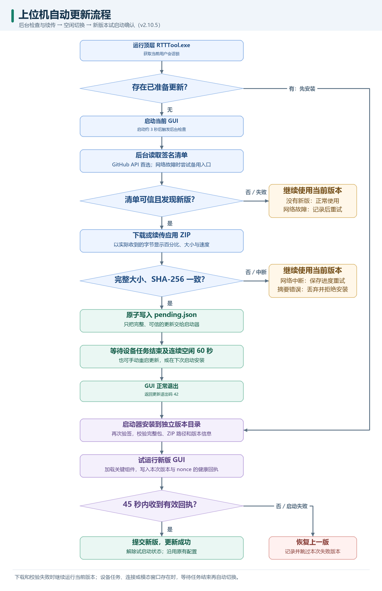
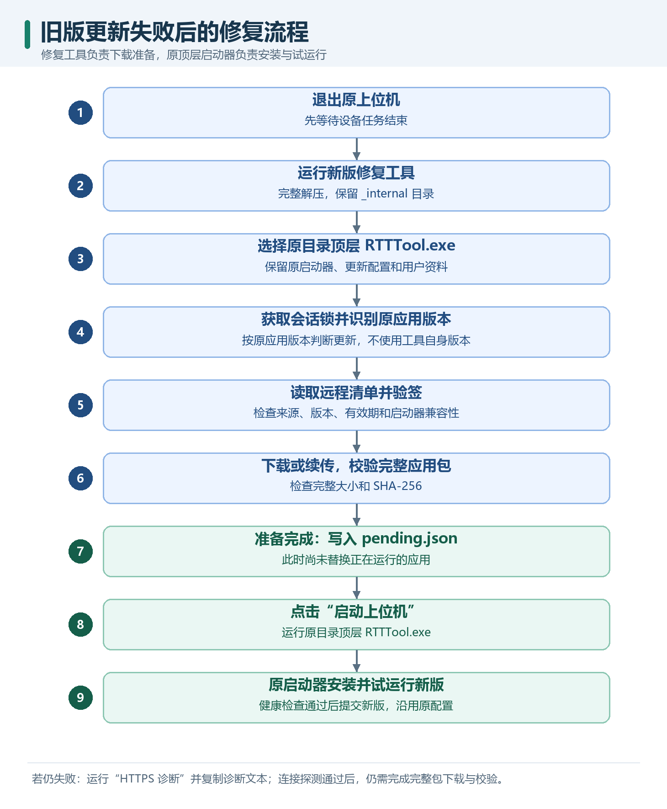
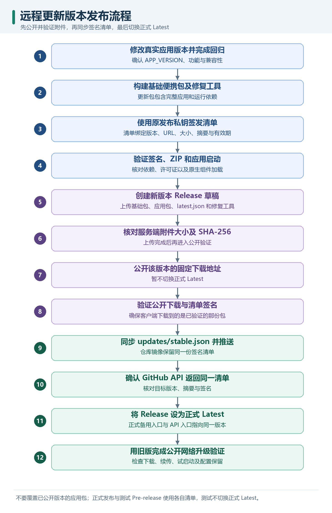

# 上位机远程更新实现与故障修复说明

整理日期：2026-11-04。实现基线：`G:\rtt_db`，v2.10.5，源码提交 `9ae3830`。

当前方案由独立启动器、上位机内的更新客户端、GitHub 上的签名清单及完整应用包组成。上位机在后台下载并校验新版，等设备任务结束、界面空闲后退出，由启动器安装和试运行新版；新版启动检查失败时恢复上一版。

本文记录 Windows 上位机程序自身的更新实现及本轮故障处理。SC201 设备的蓝牙固件升级另见 [多设备 OTA 说明](SC201_BATCH_OTA.md)。本文区分已确认的故障阶段、修复措施和仍需现场复测的条件。

下方三张流程图使用 PNG 图片，无需安装 Mermaid 插件。可在 Markdown 预览中查看，也可以点击“打开原图”单独打开并放大。图片和 Mermaid 源文件保存在 `docs/images/auto_update/`，PNG 重绘脚本为 [render_update_diagrams.py](../tools/render_update_diagrams.py)。

## 1. 程序如何获取远程版本

### 1.1 四个组成部分

| 组成部分 | 职责 | 工程位置 |
| --- | --- | --- |
| 顶层 `RTTTool.exe` | 持有会话锁，启动 GUI，安装已准备好的更新，执行试启动与回退 | [launcher.py](../app_update/launcher.py) |
| 应用 `RTTToolApp.exe` | 显示业务界面，后台检查、下载，显示进度，决定何时退出切换 | [qt_client.py](../app_update/qt_client.py)、[core.py](../app_update/core.py) |
| 签名清单 | 告知目标版本、包地址、大小、摘要、有效期和所需启动器 API | [stable.json](../updates/stable.json)、[publish.py](../app_update/publish.py) |
| GitHub Release 附件 | 存放基础便携包、应用更新包、清单、旧版修复工具 | [v2.10.5 Release](https://github.com/russel-ad/rtt_db/releases/tag/v2.10.5) |

用户应完整解压基础便携包并运行顶层 `RTTTool.exe`。直接运行内部应用 EXE，会缺少启动器建立的更新环境；随意取出一个 EXE，也可能缺少 `_internal` 等依赖。

基础包大致结构如下：

```text
RTTTool_AutoUpdate_2.10.5/
├─ RTTTool.exe                 独立启动器
├─ _internal/                 启动器运行依赖
├─ updater.json               正式清单地址、发布公钥、启用开关
└─ app/
   └─ 2.10.5/
      ├─ RTTToolApp.exe        该基础包携带的应用版本
      ├─ app-release.json
      └─ _internal/           应用运行依赖
```

后续下载的应用版本安装到当前 Windows 用户的更新目录，基础包里的启动器继续使用。普通应用更新包不替换顶层启动器或 `updater.json`；将来若启动器 API 不兼容，需要重新分发基础包。

### 1.2 当前使用的地址

| 用途 | 地址或规则 |
| --- | --- |
| 正式清单首选入口，v2.10.4 起 | `https://api.github.com/repos/russel-ad/rtt_db/contents/updates/stable.json` |
| 正式清单备用入口及旧版入口 | `https://github.com/russel-ad/rtt_db/releases/latest/download/latest.json` |
| v2.10.5 应用更新包 | `https://github.com/russel-ad/rtt_db/releases/download/v2.10.5/RTTTool-2.10.5-windows-x64.zip` |
| 原始文件域名 | 当前正式客户端读取 API 响应中的内容，不需要访问 `raw.githubusercontent.com` |
| 安装包实际下载域名 | GitHub 可能重定向到 `release-assets.githubusercontent.com`，每次仍校验 HTTPS |

API 返回的是文件信息，其中 `content` 为 Base64 编码的清单。客户端直接解码该字段，再验证内层签名；不会为了取文件而继续访问 API 响应中的 `download_url`。

这些地址承担不同任务。因此，浏览器能显示一个 JSON，只能说明该浏览器到该地址可达；安装包下载、程序使用的证书链、代理及完整传输仍要分别验证。

### 1.3 清单如何防止误更新

清单包含三部分：`payload`、`key_id`、`signature`。`payload` 的主要字段如下：

| 字段 | 实际作用 |
| --- | --- |
| `schema`、`app_id`、`platform` | 限定清单格式、目标应用和 `windows-x64` 平台 |
| `version` | 与当前版本及已见版本比较，拒绝版本倒退 |
| `url` | 版本固定的 HTTPS 应用包地址 |
| `size`、`sha256` | 校验完整包大小与 SHA-256；同版本不得换成另一份包 |
| `entry` | 指定入口为 `RTTToolApp.exe` |
| `min_launcher` | 检查当前启动器是否支持该更新 |
| `published_at`、`expires_at` | 检查清单时间范围，构建工具默认签发 90 天有效期 |

发布端对规范化后的 `payload` 做 Ed25519 签名，客户端用已有公钥验签。发布私钥由发布账号的 Windows DPAPI 保护，保存在仓库外；客户端不携带发布私钥或 GitHub 访问令牌。

HTTPS 验证服务器连接，Ed25519 验证发布清单，SHA-256 验证完整安装包，三者分别检查不同环节。

## 2. 一次自动更新的完整流程



[打开原图](images/auto_update/auto_update_flow.png) · [Mermaid 源文件](images/auto_update/auto_update_flow.mmd)

### 2.1 检查和下载

1. GUI 启动后约 3 秒触发检查；检查在线程中执行，通过 Qt 信号更新界面。
2. 正式渠道先读取 API 清单；可恢复的网络故障按限次策略重试，再尝试备用入口。
3. 验证清单签名、平台、时间、版本和启动器兼容性。没有可用新版时继续使用当前版本。
4. 下载到更新缓存中的 `.part` 文件；已有匹配且校验通过的完整 ZIP 可以复用。
5. 下载完成后检查大小和完整 SHA-256，通过后将 `.part` 改名为完整 ZIP。
6. 最后才原子写入 `pending.json`，表示已有可供启动器安装的更新。

界面上“正在下载”不等于收到安装包数据。连接、重试、传输、校验和等待切换分别有不同状态。进度到 100% 后，还需要校验和安装启动检查。

### 2.2 何时自动切换

程序每秒检查空闲条件。以下活动会阻止自动重启：

- SC201 工作台正在连接、运行任务、批量 OTA 或等待设备重启验版。
- BLE DFU、出厂配对页面仍连接设备或执行操作。
- RTT／串口仍连接，资源发送或取消流程仍在执行。
- 当前存在模态对话框。

任务结束后，还需要连续 60 秒没有相关用户输入，才触发自动退出。鼠标、键盘和滚轮活动会更新空闲计时。用户也可以选择“更新 → 重启并更新”，或正常关闭后在下次启动时安装。

这个等待条件来自 [busy_reason() 与 tick()](../app_update/qt_client.py)。更新器没有另行安装后台服务，软件未运行时不会自行下载更新。

### 2.3 安装、试启动和回退

启动器在 GUI 退出后执行 `install_pending()`，再次验签并检查缓存包。它先解压到本次新建的 `.stage-…` 目录，检查 ZIP 路径及入口版本信息，再将完整目录切换为正式版本目录。

`current.json` 先记录新版本、上一版本和 `trial: true`。新 GUI 完成关键原生组件加载及事件循环启动检查后，写入含版本号和本次随机 `nonce` 的健康回执。启动器核对回执，才把试启动状态改为成功。

45 秒内没有有效回执，或试启动失败，启动器恢复上一版，并把失败版本加入 `failed_versions`，避免重复安装同一坏版本。已经成功启动后的业务故障不由这项启动检查覆盖。

下载失败通常还没进入安装阶段，此时继续运行当前版本；它与已经安装新版后触发的回退是不同阶段。

## 3. 升级失败后，具体修复了什么

### 3.1 故障与修改总表

| 现象／错误 | 已确认的信息 | 处理方式与对应版本 |
| --- | --- | --- |
| 早期启动报 `Could not create temporary directory!` | 处于 EXE 启动阶段，尚未运行更新客户端；截图不能单独确定临时目录不可用的具体原因 | 分发完整 `onedir` 便携目录，减少对单文件 EXE 自解压临时目录的依赖；保留 `_internal` |
| 测试包可更新，正式包不更新 | 两者使用不同清单及测试资料目录；测试链路成功不能单独证明正式入口可用 | 明确正式 Latest 与 Pre-release 测试地址；分别验证正式清单和包，沿用正式顶层启动器 |
| 只显示“更新暂不可用”，不知道失败位置 | 旧提示缺少定位信息 | v2.10.2 起加入更新详情和错误日志，显示异常类型、错误文本、目标版本、传输信息 |
| 下载时没有进度条和实时数字 | 旧 GUI 的可见进度不足 | v2.10.2 起显示实际字节百分比、已下载／总大小、平均速度与状态 |
| 提示下载后断线，下一次又重新下载 | 连接成功后的响应读取也可能失败 | v2.10.3 起保留 `.part`，限次重连，使用 HTTP Range 续传；最终校验完整包 |
| 旧版下载器无法取得包含修复的新版本 | 首次升级仍执行旧版代码 | 提供独立修复工具，先为原启动器准备可信更新包，再由原启动器安装 |
| v2.10.2 的 `target_version: null`、`download: null`、`TimeoutError` | 该次失败发生在读取清单阶段，尚未识别目标版本 | v2.10.4 增加 API 清单入口、响应读取重试、入口切换和入口级错误记录 |
| API 可打开，原始文件地址不可打开 | 用户实际网络对不同域名的连通性有差异 | v2.10.4 直接解码 API 响应中的 Base64 文件内容，避免依赖原始文件域名 |
| v2.10.4 修复工具报 `CERTIFICATE_VERIFY_FAILED`、`unable to get local issuer certificate` | 另一台电脑无法构建当前连接的可信签发者链；具体缺失项或代理影响尚未在该电脑上单独确认 | v2.10.5 使用 Windows 原生链校验并提供包内公共 CA，增加 HTTPS 诊断 |
| 本机回归期间出现 `UNEXPECTED_EOF_WHILE_READING` | 本次记录为 TLS 连接被中断，诊断中 `certificate_error: false` | 保留失败和部分数据，用已有代理恢复连接并验证续传；这项网络故障仍取决于现场线路 |
| 用户反馈重启后可下载 | 已观察到恢复，未单独证明重启修复了哪个组件 | 客户端提供定期重查及限次重连；不把重启作为更新的必要步骤 |

### 3.2 v2.10.2：让失败和进度可见

修改集中在 [qt_client.py](../app_update/qt_client.py) 以及 [core.py](../app_update/core.py) 的传输回调。

进度取实际收到的字节数：

```text
百分比 = 当前文件已接收字节数 × 100 ÷ 清单规定的总字节数
平均速度 = 本轮新增网络字节数 ÷ 本轮下载经过时间
```

界面约按 0.2 秒节流刷新，关键阶段立即刷新。续传时百分比包含已有文件前缀；平均速度统计本轮传输，连接等待也会影响平均值。界面显示百分比、大小和速度，另有空闲重启倒计时。

“更新 → 查看更新详情”保留 `error_type`、`error`、清单地址等字段，后台错误也写入 `last-check-error.json`。因此后续能从用户日志定位到清单读取超时，而不必只凭“更新不可用”推测。

### 3.3 v2.10.3：处理连接成功后的断线和超时

核心改动在 [download.py](../app_update/download.py)。原先仅重试建立请求，并不能覆盖响应体读取时的超时、提前结束或 TLS 中断。现在下载循环把这些读取异常也纳入可恢复处理。

设部分文件已有 `N` 字节，下次发送 `Range: bytes=N-`：

| 服务端响应 | 客户端处理 |
| --- | --- |
| `206 Partial Content` | 验证 `Content-Range` 的起点、总长和本段长度，再追加 |
| `200 OK`，忽略 Range | 从头写入完整响应，避免把全量内容追加到旧前缀后 |
| 范围、编码或大小不匹配 | 拒绝该响应，不产生可安装的更新 |
| 可恢复的网络中断 | 保存部分文件，限次重试；耗尽后等待下轮检查或再次操作 |
| 最终摘要不一致 | 拒绝安装并丢弃不可信的部分包 |

缓存名称包含版本和包摘要前缀，避免不同版本混用部分文件。即使恢复的是以前收到的字节，最后仍对整个 ZIP 做 SHA-256 校验。

### 3.4 v2.10.4：修复清单入口和响应读取

用户提供的关键日志为：

```json
{
  "current_version": "2.10.2",
  "target_version": null,
  "download": null,
  "error_type": "TimeoutError",
  "error": "The read operation timed out"
}
```

结合该次正式清单地址及空的传输状态，可以定位到清单读取阶段。随后用户确认：GitHub API 地址可以打开，`raw.githubusercontent.com` 地址不能打开。

新增 [manifest.py](../app_update/manifest.py)，处理以下流程：

1. 识别原有正式 `feed_url`，自动把仓库 API 清单放在首选位置。
2. 解码 API 的 `content`，检查 Base64、声明大小、文件类型等；清单读取设 64 KiB 上限。
3. 对网络异常及响应体读取中断进行限次重试，API 不可用时尝试 Release 清单。
4. 把取得的内层清单交给原 Ed25519 验签逻辑。
5. 成功时记录 `manifest-source.json`；耗尽入口时记录各次尝试的 URL、异常类型和原因。

旧启动器旁的 `updater.json` 会被保留。新版应用根据其中已有的正式地址推导 API 入口，因此安装应用更新后即可采用新入口，无需覆盖用户的启动器配置。

显式测试地址仍使用自己的清单。证书验证失败会直接报告，签名或内容校验失败也不通过切换入口绕过。

### 3.5 v2.10.5：修复证书来源兼容性并增加诊断

这次用户截图来自另一台电脑，修复工具停在 0%，错误为：

```text
[SSL: CERTIFICATE_VERIFY_FAILED]
certificate verify failed: unable to get local issuer certificate
```

这表明连接当前无法找到可信的签发者链。可能涉及根证书、中间证书或网络代理提供的证书链；现有截图不足以确定该电脑具体缺少哪一张证书。

新增 [tls.py](../app_update/tls.py)，在更新请求中显式创建独立 TLS 上下文：

```python
context = truststore.SSLContext(ssl.PROTOCOL_TLS_CLIENT)
context.load_verify_locations(cafile=certifi.where())
context.verify_mode = ssl.CERT_REQUIRED
context.check_hostname = True
context.minimum_version = ssl.TLSVersion.TLSv1_2
```

Windows 版本通过 `truststore==0.10.5` 使用 CryptoAPI 构建证书链，并加载 `certifi==2026.10.23` 公共 CA。当前发行包的 CA 集包含 118 张证书，实际文件及摘要已在打包后验证。

对应的构建修改包括：

- [requirements_ble_dfu.txt](../requirements_ble_dfu.txt) 固定两项依赖版本。
- [build_ble_dfu.ps1](../build_ble_dfu.ps1)、[build_auto_update.py](../tools/build_auto_update.py)、[build_update_repair.py](../tools/build_update_repair.py) 显式收集 CA 文件、Windows 证书模块、包元数据及许可证。
- [core.py](../app_update/core.py) 的 HTTPS 请求使用 `VerifiedHTTPS` 处理器。
- [repair.py](../app_update/repair.py) 和更新详情加入证书诊断信息。

域名、有效期和可信签发者仍要通过检查。更新模块不全局替换其他模块的 SSL 行为，也不向系统导入证书。

发生重定向后的 HTTPS 错误时，诊断记录实际出错域名；临时下载 URL 的查询参数不会放入这个域名字段。可用字段包括：

| 字段 | 含义 |
| --- | --- |
| `backend` | Windows 下应为 `Windows CryptoAPI` |
| `truststore_version`、`certifi_version` | 当前工具带的校验实现和公共 CA 版本 |
| `ca_bundle_present`、`bundled_ca_count`、`ca_bundle_sha256` | 包内 CA 文件是否存在及其版本证据 |
| `failed_host` | 发生错误的实际 HTTPS 域名 |
| `certificate_error` | 此异常是否为证书验证失败 |
| `verify_code`、`verify_message` | 系统或 TLS 库提供的验证错误信息 |

## 4. 当前超时和重试参数

| 层次 | 当前参数 | 说明 |
| --- | --- | --- |
| 启动后的首次检查 | 约 3 秒后 | 来自 GUI 定时器 |
| 运行期间检查 | 间隔约 300 秒 | 当前没有待安装更新时检查；下载线程仍运行时不重复开启 |
| 每个清单入口 | 最多 2 次，网络超时参数 15 秒 | 包含建立请求及响应读取的异常处理；部分非瞬态 HTTP 错误直接转下一入口 |
| 应用包建立请求 | 每次最多 3 次，超时参数 45 秒 | 图中或日志中的“3/3”对应这一层 |
| 应用包传输循环 | 最多 6 轮 | 每轮可重新建立请求，从已有偏移恢复 |
| 下载循环预算检查 | 900 秒 | 在读取循环中检查预算，超出则保留部分文件 |
| 自动重启空闲等待 | 连续 60 秒 | 需同时满足任务及界面空闲条件 |
| 新版试启动检查 | 45 秒 | 由启动器等待有效健康回执 |

这些参数处在不同层次。15 秒和 45 秒是底层网络操作的超时参数，重定向、重试、证书链构建和多次读取可能累加；900 秒预算也在循环中检查，不能作为严格的整次更新墙钟上限。网络故障的“3/3”与应用包传输的“6 轮”也不能混为一个计数。

## 5. 旧版无法更新时，修复工具如何工作

旧版执行首次升级时，检查和下载仍由旧版代码负责。即使远端已发布修复，旧下载器也可能取不到新版。因此提供可单独分发的 `RTTTool_UpdateRepair_2.10.5.zip`。



[打开原图](images/auto_update/update_repair_flow.png) · [Mermaid 源文件](images/auto_update/update_repair_flow.mmd)

工具从原目录和更新状态读取当前版本，使用内置正式更新地址及发布公钥，准备与原启动器兼容的更新。它不会把“工具自己的版本”当成原应用版本，也不会在下载时覆盖正在运行的应用。

操作步骤：

1. 设备任务结束后，退出上位机。
2. [下载修复工具](https://github.com/russel-ad/rtt_db/releases/download/v2.10.5/RTTTool_UpdateRepair_2.10.5.zip)，完整解压，保留 `_internal`。
3. 运行工具，选择原便携目录顶层 `RTTTool.exe`，点击“下载并准备更新”。
4. 准备完成后点击“启动上位机”，由原启动器完成切换。
5. 仍失败时点击“HTTPS 诊断 → 复制诊断”，提供文本诊断结果。

HTTPS 诊断会读取并验签正式清单，连接清单指定的应用包并读取 ZIP 的前 4 字节。它不准备或安装更新；诊断通过代表当次连接和清单验签通过，完整包仍需另行下载和校验。

## 6. 配置为什么能够保留

更新后的主要目录结构为：

```text
%LOCALAPPDATA%\RTTTool\
├─ data\                         稳定的配置与日志目录
│  └─ config.json
└─ updates\
   ├─ cache\                     部分文件和完整 ZIP
   ├─ versions\<版本>\           已安装的应用版本
   ├─ health\                    本次启动的健康回执
   ├─ pending.json               已下载待安装的签名清单
   ├─ current.json               当前、上一版、试启动及失败版本状态
   ├─ seen.json                  已见版本和摘要，防止倒退或同版本换包
   ├─ manifest-source.json       最近成功取得清单的入口
   ├─ last-check-error.json      GUI 最近检查或下载错误
   ├─ last-repair-error.json     修复工具错误
   └─ last-https-check.json      修复工具的 HTTPS 诊断结果
```

这些记录按实际发生的操作生成，不是每台电脑都会同时存在所有文件。启动器把 `RTT_DATA_DIR` 指向稳定的 `data`，应用版本目录可以切换，配置路径继续沿用。[config_manager.py](../config_manager.py) 还支持首次导入旧启动器旁的配置。

工作台原先选择的资料目录继续使用，部分原生模块设置仍遵循现有 Windows 用户配置。发布包不打入用户账号缓存或工作台私有资料，安装流程也不清理这些用户资料。`session.lock`、`download.lock` 使用进程持有的文件锁协调操作；遇到正在运行的实例时，应先正常退出实例后再操作。

## 7. 后续如何正确发布新版

### 7.1 每份附件的用途

| 附件 | 谁使用 |
| --- | --- |
| `RTTTool_AutoUpdate_<版本>.zip` | 新电脑首次安装，包含顶层启动器和一份应用 |
| `RTTTool-<版本>-windows-x64.zip` | 自动更新下载，包含完整应用及依赖 |
| `latest.json` | 客户端检查版本并验证发布签名 |
| `RTTTool_UpdateRepair_<版本>.zip` | 旧客户端首次更新失败时使用 |

### 7.2 发布顺序



[打开原图](images/auto_update/update_publish_flow.png) · [Mermaid 源文件](images/auto_update/update_publish_flow.mmd)

先公开实际包，再更新镜像清单，最后切换 Latest，能够避免清单已宣布新版、附件却仍不可下载。正式和 API 入口应提供同一份签名内容。测试 Pre-release 使用单独清单，不改变正式 Latest。

常用构建命令如下；应先修改 [APP_VERSION](../app_update/__init__.py)，并为每次构建选择尚未使用的后缀：

```powershell
python -m unittest discover -s tests_app_update -q

python tools/build_update_repair.py --suffix update_repair_<本次唯一标识>

python tools/build_auto_update.py --private-key "$env:LOCALAPPDATA\RTTToolPublisher\release.key" --suffix auto_update_<本次唯一标识>
```

附件已公开并验证后，准备仓库内的签名镜像：

```powershell
python tools/sync_update_feed.py --manifest dist/RTTTool_Release_<版本>/latest.json
```

构建和同步工具不自动上传、提交或推送。`sync_update_feed.py` 会验签，拒绝镜像倒退及同版本换包；随后由发布者核对、提交推送，再切换 Latest。不要为后续发布重新生成一把无关私钥，也不要把旧二进制仅改名称当成新版本。

## 8. 再次失败时如何定位

先查看“更新 → 查看更新详情”，或使用新版修复工具的“HTTPS 诊断”。按阶段判断：

| 观察 | 优先查看 |
| --- | --- |
| `target_version` 和 `download` 为空，出现超时 | 清单入口及 `manifest_attempts`，判断请求还是响应读取中断 |
| `certificate_error: true` | `failed_host`、`verify_code`、`verify_message`、CA 文件状态和电脑时间 |
| `UNEXPECTED_EOF_WHILE_READING` | 当前网络／代理到该域名的 TLS 连接；与“缺少可信签发者”分别处理 |
| 已识别目标版本，进度暂停 | 包下载地址、`.part` 大小、重试与续传状态 |
| 大小、范围或 SHA-256 错误 | 响应是否完整、Range 是否匹配、清单和已公开包是否一致 |
| 已下载但未切换 | 是否存在连接、设备任务、模态对话框或持续用户输入 |
| 新版启动后回到旧版 | `last-error.json` 的安装／启动阶段，以及 `current.json` 的失败版本 |
| 提示另一个任务运行 | 是否还有上位机或修复工具实例持有当前更新目录的锁 |

“有网络”只描述一般联网状态，实际更新还依赖这些 HTTPS 域名可达。当前分发源是 GitHub；程序没有内置代理账号，也没有保证所有网络均能访问。若后续需要更稳定的现场分发，可再部署受控的 HTTPS 清单与包服务，继续沿用签名和完整性校验机制。

## 9. 已验证的结果及其范围

截至 v2.10.5，本次已完成：

- 61 项更新回归通过，包括真实本地 TLS 握手：可信签发者连接成功，未知签发者、域名不匹配、过期证书及 HTTPS 降级被拒绝。
- 解压后的启动器、GUI 和修复工具检查通过；主程序及工具内的 Windows 校验后端、CA 文件、摘要及依赖许可证验证通过。
- 在外部 CA 路径不可用的测试环境下，冻结后的修复工具仍能使用包内 CA 完成公开清单验签及包连接探测。
- 公开修复 ZIP 的下载大小、SHA-256 和 ZIP 完整性验证通过。
- 原 v2.10.0 启动器已完成 v2.10.5 的隔离安装及启动检查，配置标记保留。
- 公开网络测试发生过 TLS EOF 和等待超时；后续显式使用本机已有代理，从保留的 `80,412,672` 字节继续传输，验证完整 `87,040,653` 字节包，再由原启动器成功安装并启动 v2.10.5。

续传测试最初预置了 4 MiB 文件前缀，其余保留字节及最终剩余数据来自公开下载。记录中的 `60.375` 秒是对该已保留部分文件再次恢复到安装启动成功的本轮耗时，不能作为从零下载完整包的耗时，也不能用于衡量设备固件升级速度。

当前 v2.10.5 包 SHA-256 为：

```text
8290ad7dcea373d8403a22fa2497eb608d3d319f88b34a99101d8b418aa2a01e
```

本机证据保存在 `build/auto_update_2105_20261104_r1/`：`validation.json`、`checkpoint.json`、`public_recovery_first_attempt.json`、`resumed-online_upgrade_result.json` 和 `publication.json`。`build/` 被 Git 忽略，这些是本机验证记录，不随源码提交或应用包分发。

这些结果验证了当前实现及本机环境下的恢复链路。另一台电脑的实际证书、代理和线路环境仍需要用新版复测，不能由本机通过直接推定其已恢复。

## 10. 修改入口与相关文档

| 代码位置 | 阅读重点 |
| --- | --- |
| [app_update/qt_client.py](../app_update/qt_client.py) | 后台线程、进度、更新详情、空闲判断和重启触发 |
| [app_update/manifest.py](../app_update/manifest.py) | API 解码、正式／测试入口、响应读取重试 |
| [app_update/tls.py](../app_update/tls.py) | 独立 TLS 上下文、Windows 证书链、公共 CA、错误域名 |
| [app_update/download.py](../app_update/download.py) | `.part`、Range、可恢复异常和最终摘要检查 |
| [app_update/core.py](../app_update/core.py) | 验签、状态记录、ZIP 检查、安装及回退 |
| [app_update/launcher.py](../app_update/launcher.py) | 会话锁、GUI 生命周期、试启动健康检查 |
| [app_update/repair.py](../app_update/repair.py) | 旧版恢复流程、HTTPS 探测及可复制诊断 |
| [app_update/publish.py](../app_update/publish.py) | 发布签名、DPAPI 私钥保护和包生成 |
| [tools/sync_update_feed.py](../tools/sync_update_feed.py) | 签名镜像同步及版本／摘要一致性检查 |
| [tests_app_update](../tests_app_update/) | 签名、续传、安装回退、入口、TLS 和修复工具回归 |

历史修复提交：`1b8ffe8` 为 v2.10.4 清单入口修复，`e1065cf` 为 v2.10.5 证书兼容性修复，`9ae3830` 同步 v2.10.5 正式签名镜像。其余功能沿革见 [CHANGELOG](../CHANGELOG.md)。操作简表见 [自动更新说明](AUTO_UPDATE.md) 与 [旧版修复说明](UPDATE_DOWNLOAD_REPAIR.md)。
